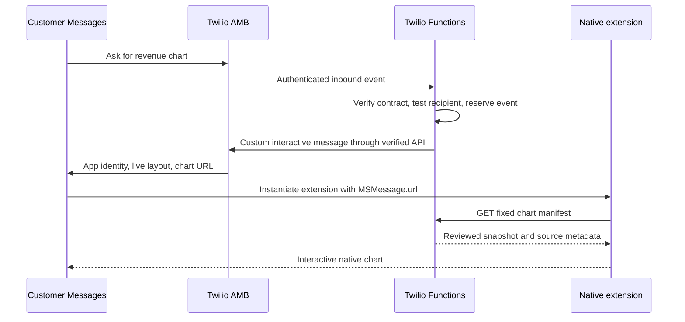

# Researched integration pattern

Reviewed October 12, 2026. This file separates platform evidence from the Twilio account-specific contract that remains unavailable.

Selected implementation: **iMessage app extension with live layout**. Two packaging paths are now separate: a standalone Messages product with a packaging wrapper, and a regular iOS app with an extension. See `packaging-paths.md`. App Clip source is optional and excluded from both delivered projects.

## Platform mechanism

An AMB Custom Interactive Message (CIM) identifies the iMessage app/extension and carries a URL with app-specific data. The Messages framework delivers that URL as `MSMessage.url`. A live layout causes Messages to instantiate the extension's view controller and place its view inside the transcript. The extension can present an expanded interface and share app-safe code with its containing iOS app.

This is compiled extension code installed on the device. It is not arbitrary native code downloaded in a message, automatic extraction of an existing app screen, or a web iframe in a normal text bubble.

Our implementation reuses one native chart view and a reviewed data model in the full app, extension and App Clip. It preserves the existing Financial Charts web runtime for fallback. The message carries identifiers, while the manifest endpoint serves the same immutable, verified revenue snapshot.

## Responsibilities and event flow

The Twilio delivery step in this diagram is the intended path; it has not been exercised. Standard Apple pickers and forms are different from a custom chart extension.

## Evidence and limits

| Source | Verified finding | What it does not establish |
| --- | --- | --- |
| Apple Messages framework | A Messages extension can be standalone or embedded in an iOS app | Twilio wire format |
| Apple MSMessageLiveLayout | Custom interactive transcript UI, separate controller instances, alternative layout when unavailable | Distribution eligibility for an AMB test account |
| Apple MSMessage.url | App data can travel in the message URL; HTTP, HTTPS and data schemes are supported | Provider-side URL encoding conventions |
| LivePerson's own CIM documentation | Its adapter uses app ID/name, Team ID + extension bundle ID in `bid`, session UUID, live-layout flag, URL and fallback metadata | A Twilio request body |
| Webex Connect's own AMB API | It independently documents iMessage-app custom messages, URL handoff and live layout | A Twilio endpoint or SDK method |
| Twilio May 21, 2026 product article | Lists app extensions among AMB capabilities | Account access or a usable CIM API schema |
| Twilio May 7, 2026 changelog | Announces private-beta AMB access | Proof a specific account is enabled |
| Twilio Functions visibility/invocation docs | Protected functions validate Twilio signatures; private assets and runtime callbacks are supported | Proof the beta webhook uses that validation path |

The two MSP APIs differ in field placement, requirements and defaults. Therefore this implementation keeps a provider-neutral descriptor and explicitly maps it only after receiving Twilio's actual beta contract. It never sends a LivePerson or Webex request to Twilio.

## Exact Twilio gap

Public Communications API send endpoints, authentication, operation responses, event schemas and an APPLE channel enum have now been found. See `twilio-public-evidence.md` for the correction and primary links. Still unverified: the complete custom-extension content mapping, which API/version this account supports for CIM, native capability enablement, exact AMB sender/recipient values and webhook mapping, signature compatibility, acknowledgement behavior, and app distribution/test setup. Public documentation alone does not prove these account-specific steps work.

The template `twilio/assets/amb-contract.private.json` preserves these as null/unverified. An environment switch alone cannot enable delivery. The generic transport currently supports a confirmed single-request JSON or form POST with account Basic authentication to an allowlisted Twilio API host. If the real contract requires Content template creation, OAuth, another host, multiple requests, or a different webhook protocol, implement and test that specific adapter rather than forcing it into the template.

## Primary references

All retrieved/reviewed October 12, 2026. Provider documentation is used as evidence of that provider's implementation, not as an alternative delivery service.

1. Apple Messages framework: https://developer.apple.com/documentation/messages
2. Apple live layout: https://developer.apple.com/documentation/messages/msmessagelivelayout
3. Apple URL property: https://developer.apple.com/documentation/messages/msmessage/url
4. Apple extension point: https://developer.apple.com/documentation/bundleresources/information-property-list/nsextension/nsextensionpointidentifier
5. Apple shared extension code: https://developer.apple.com/library/archive/documentation/General/Conceptual/ExtensibilityPG/ExtensionScenarios.html
6. Apple Swift Charts interactivity: https://developer.apple.com/videos/play/wwdc2023/10037/
7. Apple AMB registration overview (page updated July 21, 2026): https://register.apple.com/resources/messages/messaging-documentation/
8. LivePerson CIM: https://developers.liveperson.com/apple-messages-for-business-templates-custom-interactive-message-template.html
9. Webex AMB API: https://developers.webexconnect.io/reference/apple-messages-for-business-apis
10. Twilio AMB app-extension capability discussion: https://www.twilio.com/en-us/blog/products/launches/the-power-of-the-grey-bubble--why-apple-messages-for-business-is
11. Twilio AMB beta: https://www.twilio.com/en-us/changelog/amb-private-beta
12. Twilio function visibility: https://www.twilio.com/docs/serverless/functions-assets/visibility
13. Twilio execution: https://www.twilio.com/docs/serverless/functions-assets/functions/invocation
14. Twilio private assets: https://www.twilio.com/docs/serverless/functions-assets/assets
15. Twilio Sync Map items: https://www.twilio.com/docs/sync/api/map-item-resource
16. Twilio supported runtimes: https://www.twilio.com/docs/serverless/functions-assets/node-upgrade

## App Clip and component expansion

Version 0.3 adds the shared component catalog and mock confirmation API (`native-components.md`), plus a separate App Clip host (`app-clip-path.md`). App Clip link invocation and an iMessage live layout are separate launch paths. They share compiled SwiftUI views and a model; neither embeds the Financial Charts JavaScript runtime as a native Apple view.
