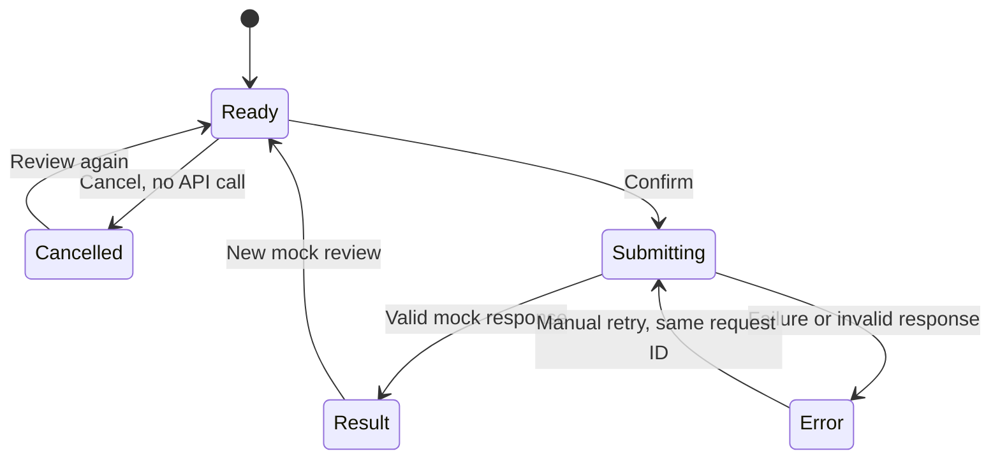

# Native component catalog and mock confirmation

Version 0.4.0, October 12, 2026. These components are our SwiftUI code built with Apple's frameworks. Twilio delivers the message or link; it does not provide or render the native chart component.

## Shared components

| URL `component` | Native UI | Data / behavior |
| --- | --- | --- |
| `bar` | Swift Charts `BarMark` | Four existing Microsoft revenue records; quarter selection |
| `line` | `LineMark` and `PointMark` | Same revenue records and USD scale |
| `pie` | `SectorMark` | Each quarter's share of the sum of the four displayed quarters; tap a sector or select a quarter |
| `data` | `RevenueDataView` | Exact source values, quarter-end dates, currency, provider, nulls, flags, filing dates and links |
| `confirmation` | `ConfirmationView` | Review the same snapshot, Confirm or Cancel, then show result |
| Result state | Native status and JSON disclosure | Response from the mock API, correlated to the request |

The pie uses `quarter value / sum(displayed quarter values)`. Its percentages are display calculations, not provider-supplied financial metrics. It is a time-period composition of revenue, not product mix, holdings, or price returns. The original chart export and all four provider records remain byte-for-byte intact.

`NativeComponent` is the allowlisted selector. `ChartScreen` chooses the view. `ChartStore` supplies one verified snapshot. All chart types reuse `RevenueDataView`; both packaging paths compile the same extension source files; the regular app also compiles the shared views. The selected host is the iMessage extension. Optional `ChartClip` source can reuse these components but is excluded from both delivered builds.

## Application-owned route

`/chart` accepts `chart_id`, `revision_id`, `session_id` (UUID), and `component`. The native client validates the exact HTTPS origin, path, keys, IDs and selector before loading remote data. Old three-field message URLs default to `bar`. Unknown/duplicate keys and unknown selectors fail visibly. These are **our URL parameters**, not asserted Twilio payload fields.

Generate a URL using your configured real origin:

```sh
cd twilio
node --env-file=.env scripts/print-launch-url.cjs pie
node --env-file=.env scripts/print-launch-url.cjs confirmation
```

The script prints a URL only; it never sends. The same URL can be carried in the extension descriptor or configured as an App Clip test invocation. See `app-clip-path.md` for registration and discovery prerequisites.

Incoming demo commands `pie`, `line`/`trend`, `data`/`table`, `bar`, and `review`/`confirm` select a component. Generic revenue/chart requests use `NATIVE_DEFAULT_COMPONENT`, initially `bar`. This command parser runs only after existing channel/account/recipient checks. A `confirm` message opens review UI and **does not call the confirmation API**.

## Mock API contract

The Confirm button invokes `ReviewAPI.confirm`. With no configured origin, it uses `LocalMockReviewAPI` and labels the UI “Local mock • no network request.” With a configured origin, it uses `HTTPMockReviewAPI` to POST JSON to `/mock-confirm`; failures stay visible and never silently switch to the local mock.

Request fields:

```json
{
  "schemaVersion": 1,
  "requestID": "01bc2b3a-8aaf-4222-9f4c-40e1cc7d15a1",
  "chartID": "b71d8906-be7f-499e-a448-044d4ec39825",
  "revisionID": "f47530da-762a-44a1-9c52-ab142462bf6f",
  "action": "confirm_snapshot_review"
}
```

The successful response is HTTP 200 with the same five fields plus:

```json
{
  "mode": "mock",
  "status": "confirmed",
  "receiptID": "mock-01bc2b3a-8aaf-4222-9f4c-40e1cc7d15a1",
  "message": "Mock review confirmed. No business action was performed."
}
```

The endpoint rejects wrong revisions/actions/versions, malformed UUIDs, and extra application fields with HTTP 422. It makes no external calls and persists nothing. Identical input yields identical output. The mock receipt is not a provider delivery receipt, audit record, transaction ID or portfolio event. This is our backend API hosted in Twilio Functions, separate from Twilio's AMB send contract.

## Interaction states



While submitting, the component picker and insertion button are disabled. Repeated Confirm attempts are ignored. Cancel is available before submission only; it does not claim to undo an in-flight request. Retry reuses the request ID, and starting another review generates a new one. Late responses from a prior review are discarded. Results are in-memory UI state, not persisted approvals, and opening/reopening a message never auto-confirms.

The native HTTP client rejects redirects and mismatched response IDs/revisions/mode, applies a 10-second timeout, and sends no Twilio credential. The public mock endpoint is deliberately non-mutating. Replacing it with a real action requires authenticated application identity, authorization, durable idempotency and server-side validation; do not turn this public demo route into a business-action endpoint.

Apple's native pie API: https://developer.apple.com/videos/play/wwdc2023/10037/
